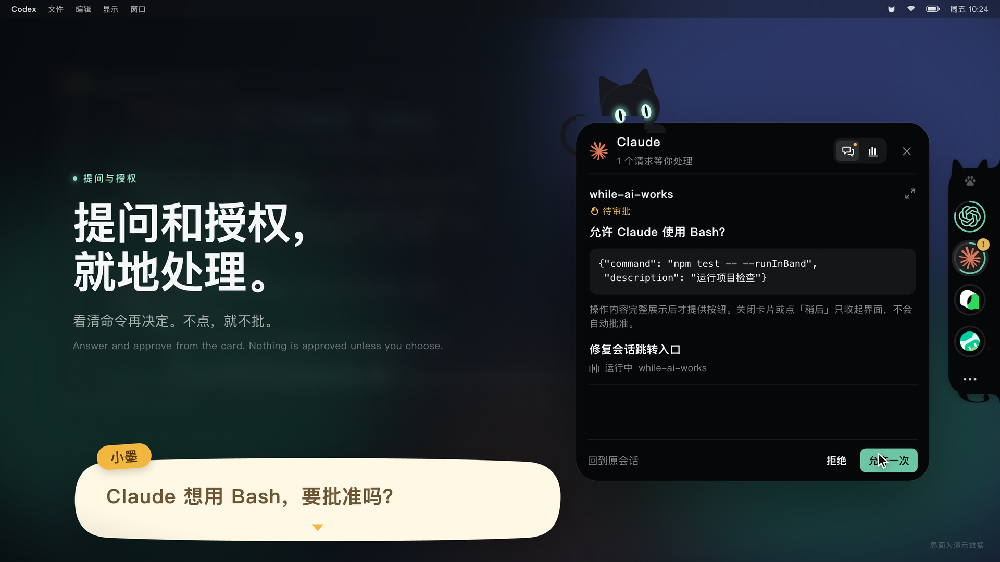
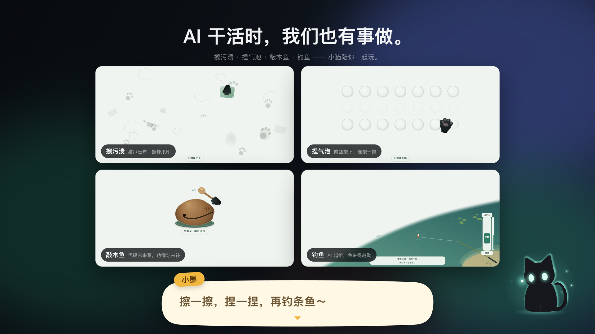

<h1 align="center">While AI Works</h1>

<p align="center"><strong>AI 干活时我们干什么</strong></p>

<p align="center">
  一只住在 Mac 桌面的小猫，帮你留意 AI 的工作，也陪你打发等待。<br>
  收成猫条，看会话、查额度、处理提问与授权；展开来，陪你擦污渍、捏气泡、敲木鱼、钓鱼。
</p>

<p align="center">
  <a href="https://github.com/xiaoyan648/while-ai-works/releases/latest"><strong>下载 Mac 版</strong></a> ·
  <a href="#视频演示">视频演示</a> ·
  <a href="#主要功能">主要功能</a> ·
  <a href="#最近迭代">最近迭代</a> ·
  <a href="#下载开玩">安装指南</a>
</p>

<p align="center"><sub>macOS 14+ · Apple Silicon / Intel · Swift 原生应用</sub></p>

## 视频演示

https://github.com/user-attachments/assets/db49fc4e-1adf-49a4-b173-da68e032c6b1

<p align="center">
  <sub>57 秒 · 点击播放器直接观看 · 配乐、音效与小猫配音 · 会话与额度使用演示数据</sub><br>
  <a href="https://github.com/xiaoyan648/while-ai-works/releases/download/v0.17.3/While-AI-Works-0.17-Promo.mp4">下载原画质视频 · 1080p60</a>
</p>

## 主要功能

### 贴边猫条，AI 的进度抬眼可见

小猫收成屏幕边缘的一条工作台。悬停预览，点击固定卡片；需要你处理的请求排在前面。

- **会话与回复**：查看工作状态和最近会话，按可用入口回到原会话；回复预览可在设置中开启。
- **提问与授权**：接入 Codex / Claude Code 的交互监听后，在卡片里回答问题、审阅操作并决定是否允许。只有你主动提交，选择才会送回原客户端。
- **额度与 Token**：查看 Codex / Claude 的账户剩余额度、重置时间，以及本机最近会话的 Token 用量和缓存命中率。
- **四边停靠**：拖到屏幕任意一边，横竖自动切换；支持浅色、深色，以及悬浮或贴边形态。



[查看额度界面](images/0.17-cat-dock-quota.png) · [查看停靠形态](images/0.17-cat-dock-edges.png) · [猫条与工作卡片详解](docs/cat-dock.md)

### 桌面小猫，陪你一起等

切到「宠物」模式，小猫就自由地住在桌面上。工作时陪着你，空闲时打个盹，钓到鱼时举起小鱼一起庆祝。

- 拖动换位置，点击摸摸；墨 / 雪两种毛色和三种尺寸可选。
- 猫爪压布擦污渍、肉垫捏气泡、握槌敲木鱼，陪你一起玩。
- 收起小游戏，小猫仍能独立关注 AI；猫条与宠物模式可随时切换。

### 四种小游戏，给人类安排点事

选「跟随 AI」，Codex、Claude Code、Hermes、DSH、Qoder、WorkBuddy 开工时，桌面也跟着热闹；选「随时开启」，想玩就玩。



| 玩法 | 人类这边的工作 |
| --- | --- |
| **擦污渍** | AI 埋头写代码，你拿起小抹布，把桌面擦干净。 |
| **捏气泡** | 点一下捏一个，划过去捏一排。 |
| **敲木鱼** | 代码它来写，功德你来补。AI 工作时每 5 秒 −1，你敲一下 +1。 |
| **钓鱼与收藏** | 蓄力抛竿、等鱼咬钩、提竿收鱼；累计鱼获解锁四阶钓竿，收集尺寸奖牌与鱼种图鉴。 |

钓到的鱼还能放进水下世界，慢慢看它们游。首次开启水下观赏时按需下载鱼缸资源，之后可离线使用；鱼获、图鉴和纪录都保存在自己的 Mac 上。

## 最近迭代

| 版本 | 这次带来了什么 |
| --- | --- |
| [**0.20.0**](docs/releases/0.20.0.md) | **Hermes / DSH 加入猫条**：本机会话与 Token、增强监听和工具审批；设置按 Agent 整理，开关对齐、接入配置集中管理。 |
| [**0.19.1**](docs/releases/0.19.1.md) | **额度读取更稳，卡片切换更顺**：修复 Codex 额度过早超时与配置误判，减少切换页签时的重复布局和刷新。 |
| [**0.19.0**](docs/releases/0.19.0.md) | **子 Agent 收进猫条**：主 Agent 下可展开查看子 Agent，折叠时仍提示待处理；自定义 Codex 中转站不再阻塞额度读取。 |
| [**0.18.1**](docs/releases/0.18.1.md) | **回答可粘贴，小猫换图标**：修复输入回答时的编辑快捷键，支持多行粘贴；应用图标换成与桌面小猫一致的墨色灵猫。 |
| [**0.18.0**](docs/releases/0.18.0.md) | **干完盖个章**：Agent 完成时小猫盖下爪印；动效更丝滑，回答按钮跟着问题走，额度页提示消耗节奏，切换 Agent 更流畅。 |
| [**0.17.3**](docs/releases/0.17.3.md) | **更轻的安装包**：鱼缸资源改为按需下载；工作卡片更宽敞，运行中的 Agent 图标更清晰。 |
| [**0.17.2**](docs/releases/0.17.2.md) | **回到原会话**：修复会话跳转入口，Claude 终端会话可复制恢复命令。 |
| [**0.17.1**](docs/releases/0.17.1.md) | **应用内更新**：新增签名更新检查，修复从 Finder 启动时的 Claude 命令检测。 |
| [**0.17.0**](docs/releases/0.17.0.md) | **小猫收成一条**：加入贴边猫条、工作卡片、提问与授权，以及额度和 Token 展示。 |

[查看全部版本与下载](https://github.com/xiaoyan648/while-ai-works/releases) · [0.16.0：桌面小猫与陪玩](docs/releases/0.16.0.md)

## 下载开玩

**[下载最新 Mac 版](https://github.com/xiaoyan648/while-ai-works/releases/latest)** · 需要 macOS 14 或更新版本，暂不支持 Windows。

| 你的 Mac | 选择安装包 |
| --- | --- |
| M 系列（Apple Silicon） | 文件名带 `arm64` 的 `.dmg` |
| Intel | 文件名带 `x86_64` 的 `.dmg` |

1. 打开 DMG，将 **While AI Works.app** 拖入 **Applications（应用程序）**。升级前先退出旧版，再替换应用；原有设置和鱼获保留。也提供 ZIP。
2. 打开应用，点菜单栏里的小猫，在「开始玩」中选一种玩法。
3. 按 **⌘⇧空格** 随时收起桌面效果，回去看看 AI 干得怎么样。

<details>
<summary>首次打开、应用内更新与 Intel 支持</summary>

如果首次打开被系统拦住，确认是从本仓库下载后，在「系统设置 → 隐私与安全性」中选择「仍要打开」，也可参照 [Apple 的操作说明](https://support.apple.com/zh-cn/102445)。当前安装包使用 ad-hoc 签名，尚无 Developer ID 签名或 Apple 公证。

0.17.1 起可在「设置 → 关于」或菜单栏右键菜单中「检查更新」，也可关闭自动检查。默认由用户确认安装，更新清单与安装包均验证签名。0.17.0 及更早版本需先手动安装一次。Sparkle 更新签名不代替 Apple 公证。

Intel 包已通过 Rosetta 下的运行与资源检查，尚未完成 Intel 真机验收。

</details>

### 连接你的 AI

在「设置 → 跟随 AI」中选择「跟随 AI 工作」，勾选想关注的客户端，支持多选。

**Codex** 可直接跟随工作状态；**Claude Code / Qoder / WorkBuddy** 首次需要点击对应的「安装监听」，再重启客户端。提问与授权另外通过「安装交互监听」接入 Codex / Claude Code，具体支持范围见 [连接与使用说明](INTEGRATIONS.md)。

Hermes / DSH 已在 0.20.0 加入猫条，工作状态、本机用量、增强监听的配置与交互范围见 [接入与验收说明](docs/hermes-dsh.md)。

多个客户端同时工作时，只要还有一个会话在运行，玩法就会跟着变化。Qoder / WorkBuddy 的连接仍需更多真实使用反馈；状态没跟上时，可先切回「随时开启」。

## 数据留在自己的 Mac

不需要注册本应用账号，不读取桌面画面，也不把对话或代码上传到独立服务。回复预览默认关闭，开启后仅在本机内存中展示；账户额度通过已登录的官方客户端查询。只有你主动提交，回答或权限选择才会送回对应会话。

## 源码与构建

需要 macOS 14+、Apple Command Line Tools（Swift 6.1+）和 Python 3。

```sh
git clone https://github.com/xiaoyan648/while-ai-works.git
cd while-ai-works
bash scripts/build.sh
open "dist/While AI Works.app"
```

首次构建下载并校验 Rive 与 Sparkle 官方依赖，Agent HUD Core 源码随仓库提供。构建结果使用本地 ad-hoc 签名；依赖就绪后可离线构建，无需生成服务 API Key 或 Blender。

[开发与检查](CONTRIBUTING.md) · [应用更新](docs/updates.md) · [小猫制作](design/mascot/README.md) · [这个小玩具的由来](docs/product-story.md)

代码采用 [MIT License](LICENSE)，第三方目录保留原许可；图片、纹理、三维模型和品牌素材的授权范围见 [资源说明](ASSETS.md)。

遇到问题或想到新玩法，欢迎 [提个 Issue](https://github.com/xiaoyan648/while-ai-works/issues)，告诉我们你的 Mac、AI 客户端和发生了什么。
