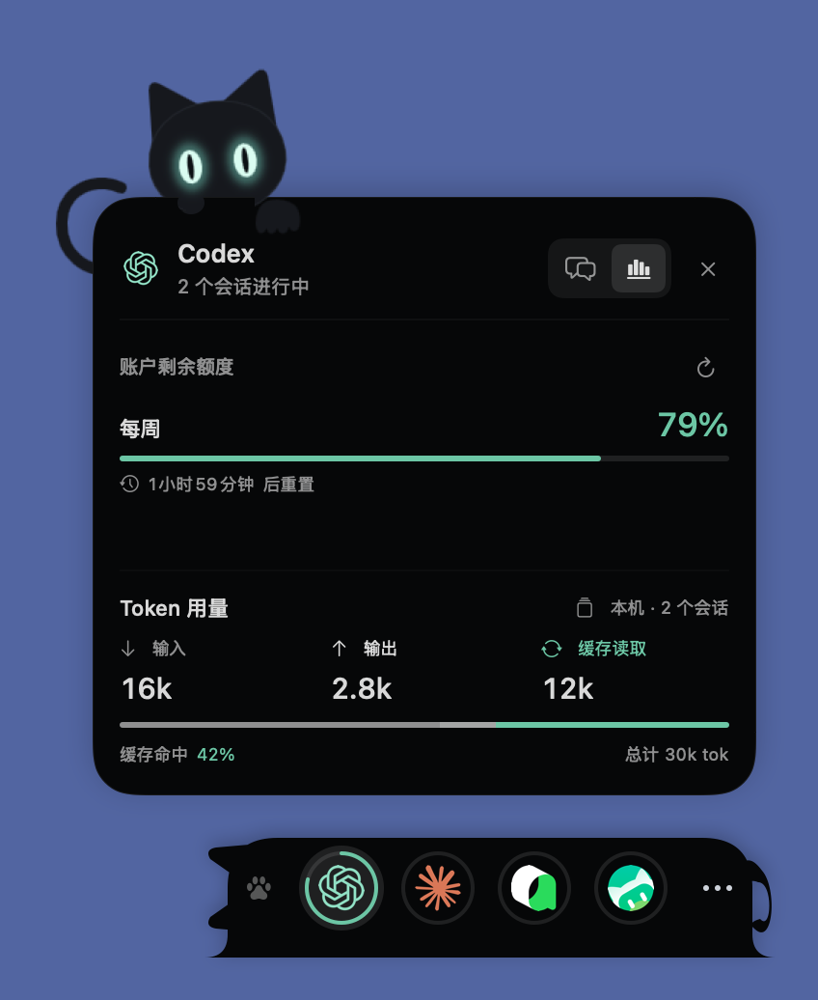
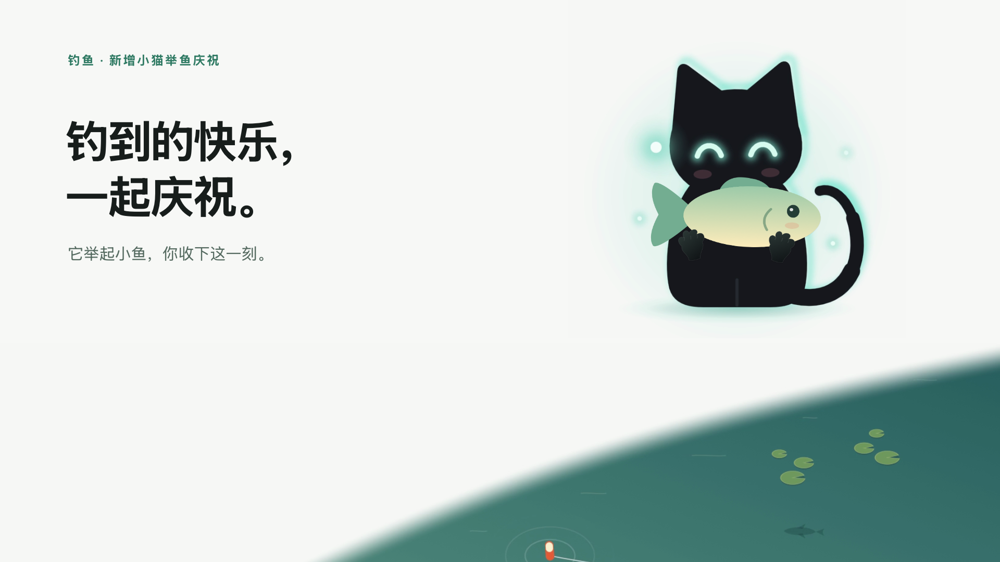
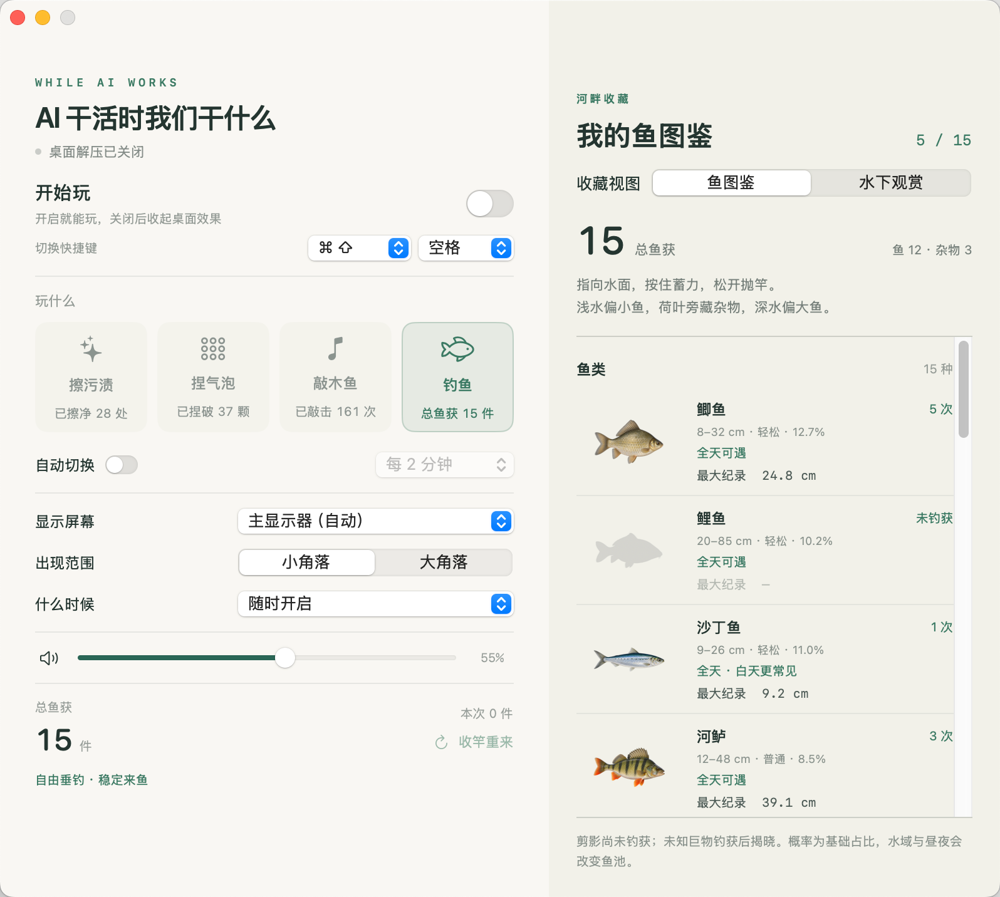
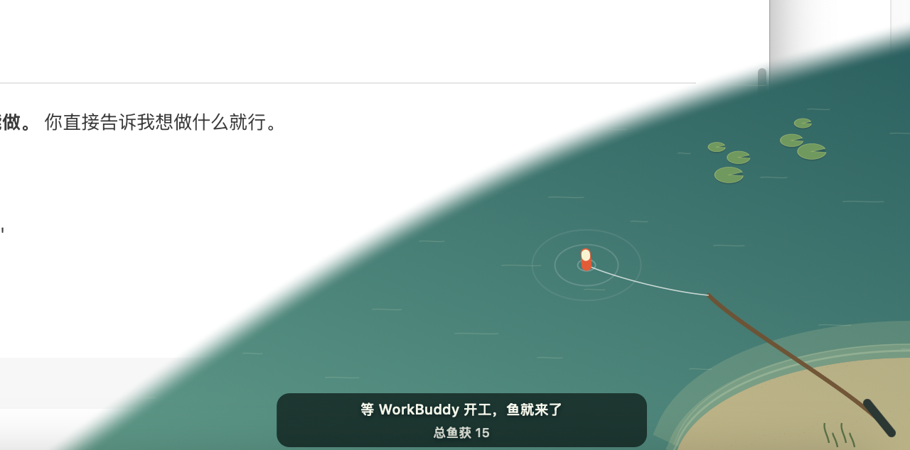
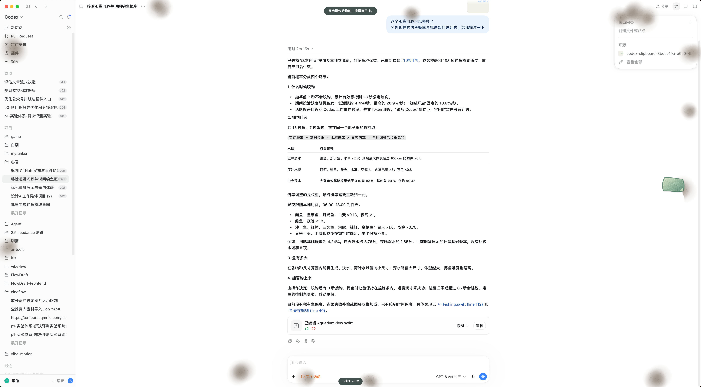
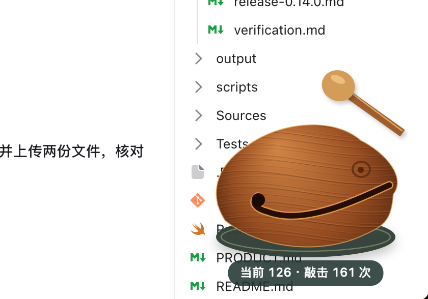

# AI 干活时我们干什么

**AI 负责写代码，我负责不闲着。**

某天下午，我把需求交给了 Codex。它开始看代码、改文件、跑测试。我盯着屏幕，突然发现自己没什么事可干了。

于是，我给自己找了份新工作。

我做了个监听 Codex 工作的小工具。它一开工，桌面就开始长污渍，我拿着小抹布去擦。它解决代码里的问题，我解决屏幕上的问题。

从程序员转岗桌面保洁，只用了一个下午。

**但我没有离开项目，只是换了个部门。**

后来，部门逐渐扩张：捏气泡、敲木鱼，以及最重要的——钓鱼。选了「跟随 AI」，它开工，鱼才开始来；它忙得越起劲，水面就越热闹。

以前盯着 AI 干活，是怕它出错。现在盯着 AI 干活，是怕它提前下班。

毕竟这边刚上鱼。

如今也能跟随 Claude Code、Qoder 和 WorkBuddy。无论哪个 Agent 在埋头工作，人类这边总有点事忙。

**主打一个：人和 AI 都有事做。**

v0.16.0 还给人类这边添了一位同事：小猫住在桌面，帮你留意 AI 的工作状态，也陪你擦污渍、捏气泡、敲木鱼。钓到鱼，它会举起来一起庆祝。

v0.17.0 新增「猫条」：小猫可以收成屏幕边缘的 AI 工作台，留意会话、查看额度，在对应卡片处理提问与授权。猫条与宠物模式可在设置中切换。



猫条界面示例，账户与会话均为演示数据。

## 45 秒，看小猫陪你上班

新版 UI、桌面小猫、AI 运行监控，以及猫爪小游戏和举鱼庆祝，都在这支 v0.16.0 宣传片里。

[](https://github.com/xiaoyan648/while-ai-works/releases/download/v0.16.0/While-AI-Works-0.16.0-Promo.mp4)

[查看 / 下载完整宣传片 · 45 秒 · 1080p · 含配乐与音效](https://github.com/xiaoyan648/while-ai-works/releases/download/v0.16.0/While-AI-Works-0.16.0-Promo.mp4)

视频中的工作状态使用演示会话，不包含真实任务内容。

## 人类这边的工作现场

**配置页面 · 给自己安排一个岗位**

玩法、声音、快捷键，以及今天的渔业成果，都在这里。



**钓鱼 · 等 AI 开工，也等鱼上钩**

Agent 还没开工，渔业部先把竿架好。



**擦污渍 · 从程序员转岗桌面保洁**

它埋头写代码，我顺手擦桌面。谁也没闲着。



**敲木鱼 · 代码它来写，功德你来补**

代码那边还在跑，人类这边也有自己的进度条。



## 给自己找点事做

- **桌面保洁**：拿起小抹布，把 AI 干活时冒出来的污渍擦干净。
- **气泡解压**：点一下，捏一个；划过去，捏一排。
- **精神支持**：AI 工作时木鱼数值每 5 秒 −1，你敲一下 +1。代码它来写，功德你来补。
- **渔业生产**：蓄力抛竿，等鱼咬钩，提竿收鱼。它越忙，来鱼越勤。
- **钓竿成长**：累计钓获解锁青竹、听雨、逐浪、沧澜四阶钓竿，更大的判定块带来更多容错。
- **奖牌与成就**：按鱼种尺寸收集银牌、金牌，挑战首次金牌和全金牌图鉴；历史鱼获自动继承。
- **下班观赏**：钓到的鱼有自己的图鉴和纪录，也能放进水下世界，慢慢看它们游。
- **桌面小猫**：在菜单栏右上角开启「桌面猫」，小猫会独立常驻，显示 Codex、Claude Code、Qoder、WorkBuddy 各自的工作状态。拖动可移动，点击可摸摸，右键可收起状态卡或小猫；位置与开关会记住。收起小游戏不影响小猫关注 AI。工作详情默认收起为会话数字气泡，点击展开；设置里可选小、中、大三种尺寸。
- **小猫陪玩**：猫爪压布擦污渍、肉垫捏气泡、握槌敲木鱼；钓到鱼后，小猫在钓鱼区域上方举起卡通小鱼庆祝，并播放轻柔的收获音效。

想自己安静玩一会儿，也可以选「随时开启」。不必等 AI 上班。

## 下载开玩

[下载 Mac 版 · 0.17.1](https://github.com/xiaoyan648/while-ai-works/releases/tag/v0.17.1)

适用于 **macOS 14 或更新版本**，请按芯片选择安装包：

- **M 系列 Mac**：下载文件名带 `arm64` 的 DMG。
- **Intel Mac**：下载文件名带 `x86_64` 的 DMG。

Intel 包已通过 Rosetta 下的运行与资源检查，尚未完成 Intel 真机验收。暂不支持 Windows。

1. 下载对应芯片的 `.dmg`，打开后将 **While AI Works.app** 拖到 **Applications（应用程序）**。升级前先退出旧版，再替换应用；原有设置和鱼获保留。也提供 ZIP。
2. 打开应用，点菜单栏里的小猫，打开「开始玩」，选一种玩法。
3. 按 **⌘⇧空格** 随时收起桌面效果，回去看看 AI 干得怎么样。

如果首次打开被系统拦住，确认是从本仓库下载后，在「系统设置 → 隐私与安全性」中选择「仍要打开」。也可参照 [Apple 的操作说明](https://support.apple.com/zh-cn/102445)。

0.17.1 起可在「设置 → 关于」或菜单栏右键菜单中「检查更新」，也可关闭自动检查。默认由用户确认安装，更新清单与安装包均验证签名。0.17.0 及更早版本需先手动安装本版一次。Sparkle 更新签名不代替 Apple 公证，当前安装包仍为 ad-hoc 签名。

## 和你的 AI 一起上班

在「设置 → 跟随 AI」的「什么时候」里选择「跟随 AI 工作」，勾选 **Codex、Claude Code、Qoder、WorkBuddy**，支持多选，默认全选。

Codex 可直接跟随。Claude Code / Qoder / WorkBuddy 首次使用需要在同一处点击对应客户端的「安装监听」，再重启对应客户端；如果客户端弹出配置确认，按提示启用即可。

可以同时跟随多个客户端。只要还有一个会话在工作，玩法就会跟着变化；最后一个结束后，剩下的可以继续玩。木鱼扣减不会因多个客户端同时工作而翻倍。

[连接与使用说明](INTEGRATIONS.md) · [猫条与工作卡片](docs/cat-dock.md)

## 放心摸鱼

不需要注册本应用账号，不读取桌面画面。鱼获、图鉴和累计记录都留在自己的 Mac 上。启用工作卡片后，可在本机内存中预览已关注客户端的回复，默认关闭，可在设置中开启；账户额度由已登录的官方客户端查询。只有你主动提交时，回答或权限选择才通过原客户端送回对应会话。应用不把对话或代码上传到独立服务。

应用住在菜单栏里：点小猫打开面板，右键打开快捷菜单。它在等你、陪你玩、盯着浮漂，AI 没开工时会打个盹；钓到鱼会跳起来，点它会蹭蹭你。显示屏幕、音量、自动轮换、快捷键和小猫毛色（墨 / 雪）都在「设置」里，支持深色模式。

## 一起养这个小玩具

Qoder / WorkBuddy 的连接还需要更多真实使用反馈；如果状态没跟上，可以先切回「随时开启」。

遇到问题或想到好玩的新玩法，欢迎 [来聊聊](https://github.com/xiaoyan648/while-ai-works/issues)。描述一下你用的 Mac、AI 客户端，以及发生了什么就好，不用贴私人对话或代码。

## 源码与构建

本项目代码采用 [MIT License](LICENSE) 开源，第三方目录保留其原许可。欢迎阅读、修改和贡献。
图片、纹理、三维模型和品牌素材的来源与许可范围见 [资源说明](ASSETS.md)，这些素材不属于代码的 MIT 授权范围。

需要 macOS 14+、Apple Command Line Tools（Swift 6.1+）和 Python 3。第三方依赖包括 [Rive](https://github.com/rive-app/rive-ios) 运行时（MIT）、[Sparkle 2.10.0](https://github.com/sparkle-project/Sparkle) 更新框架（MIT 及其第三方声明）和固定版本的 [Agent HUD Core](Vendor/AgentHUDOpen/README.md)（Apache-2.0）。Rive 与 Sparkle 首次构建时下载官方发布包并校验 SHA-256；Agent HUD Core 源码随仓库提供，用于 Codex / Claude 用量及会话接入。依赖就绪后可离线构建，不需要生成服务 API Key 或 Blender。更新发布流程与派生项目配置见 [应用更新](docs/updates.md)。

```sh
git clone https://github.com/xiaoyan648/while-ai-works.git
cd while-ai-works
bash scripts/build.sh
open "dist/While AI Works.app"
```

构建脚本生成完整应用和 Hooks 辅助程序，并使用本地 ad-hoc 签名。构建结果没有 Developer ID 签名或公证。

```sh
# 核心玩法、音效、交互、鱼模型和图鉴检查
bash scripts/check.sh
# Hooks 协议、配置安装/移除与监听集成检查
bash scripts/check-hooks.sh
# 检查已构建的真实 Hooks 辅助程序
python3 Tests/HookExecutableChecks.py
# 生成工具的离线请求测试，不调用生成服务
python3 Tests/test_volcengine_asset.py
# 菜单栏面板、设置和收藏窗口的离屏渲染（浅色 / 深色），输出到 .build/ui-review
bash scripts/check-ui.sh
```

小猫的 Rive 源文件在 `design/mascot`，制作与修改方法见 [小猫说明](design/mascot/README.md)。

更多目录说明、Intel 构建与打包方法见 [开发说明](CONTRIBUTING.md)。
