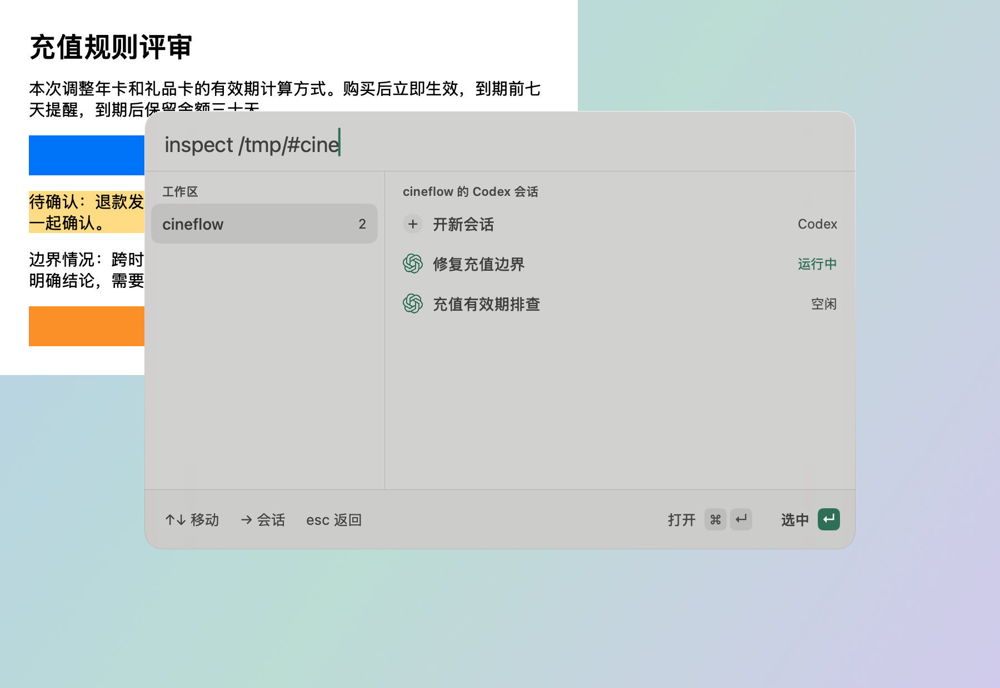

# 第一轮需求迭代：路径中的选择器符号

- **来源与读取范围：** WAW 全部公开 Issue、开放 PR、版本文档，以及 Quick Input 设计文档和原生检查。查询时没有开放产品 Issue 或在途 PR。本轮缺陷来自代码与既有产品约定的核对，未将主动检查冒充用户反馈。
- **候选与取舍：** 选择 Quick Input 路径边界缺陷。它有明确产品约定、可复现输入和局部修复范围。没有推进快捷输入新入口、Qoder/WorkBuddy 新功能或诊断导出，因为缺少新的复现反馈。
- **问题：** `inspect /tmp/#cine` 或 `inspect /tmp/@cod` 会被识别为目标选择器；选择匹配工作区或 Agent 后，路径片段会从正文删除。
- **改动：** `@` 和 `#` 前一字符为 `/` 或 `\\` 时保持普通文本；既有中文紧邻选择器、邮箱和 Issue 引用规则不变。补充原生 token 回归检查。
- **验证：** 用基线生产解析器运行新增 token 检查失败，修改后通过；`bash scripts/build.sh` 和 `bash scripts/check-quick-input.sh --snapshot .build/iteration-after` 通过。原生检查验证路径不会打开选择器，一次 Enter 将完整路径发到合成的既有会话；浅色／深色实际面板截图使用相同场景。
- **经验：** 本轮及初始化阶段的真实错误已记录在 [错题本](../iteration-lessons.md)：能力判断、CLI 附带权限查询、下载排查、构建前提和测试状态重置。每日自动化已加入每轮读写经验的要求。
- **限制：** 本轮只修复紧邻路径分隔符的选择器误判，不扩展其他语法；截图使用合成会话和背景，发送回调为测试替身，未向真实客户端发送任务。原生验证在 macOS arm64 执行，未新增 Intel 真机验收。

## 实际面板对照

Before 使用基线 `c254a5c` 的生产解析器；After 使用 `09eb0a3` 的生产代码。两者使用同一份截图脚本、相同合成会话和 `inspect /tmp/#cine` 输入，视口为 900 × 620 pt（1800 × 1240 px）。Before 错误打开工作区选择器，After 保持正文输入和原会话目标。基线仅移植本轮截图入口，没有移植生产修复；截图入口不代替完整检查。

| Before · 浅色 | After · 浅色 |
| --- | --- |
|  |  |

[Before · 深色](images/2026-11-16-path-before-dark.png) · [After · 深色](images/2026-11-16-path-after-dark.png)
